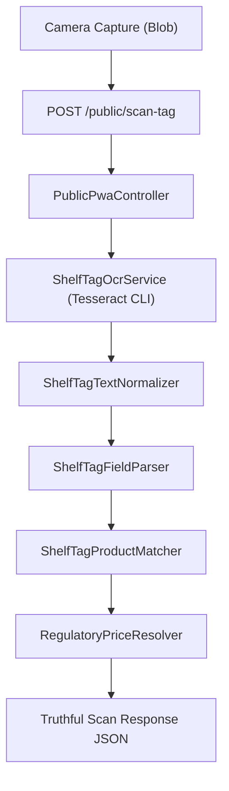

# Shelf Scanner Option A (Genuine OCR) Implementation Audit & Plan

**Date:** July 25, 2026  
**System:** PRICE-Watch Temporal Regulatory System  
**Scope:** `customer-pwa/src/components/ShelfScanner.tsx` & `backend/app/`  

---

## 1. Audit Findings & Current State Analysis

### A. Existing Files & Components Inspected
- **Frontend PWA:**
  - `customer-pwa/src/components/ShelfScanner.tsx`
  - `customer-pwa/src/components/ShelfScanner.test.tsx`
  - `customer-pwa/src/api/client.ts`
  - `customer-pwa/src/app/handoffs.ts`
  - `customer-pwa/src/data/srpFallback.ts`
  - `customer-pwa/src/App.tsx`
- **Backend Core:**
  - `backend/app/Http/Controllers/PublicPwaController.php`
  - `backend/routes/api.php`
  - `backend/app/Models/SrpBulletin.php`
  - `backend/app/Models/Store.php`

### B. Current Real vs. Mock / Synthetic Behavior
1. **Real Behavior:**
   - Real browser camera capture via `navigator.mediaDevices.getUserMedia`.
   - Aspect ratio bounding viewfinder box overlay.
   - Canvas JPEG Blob conversion.
   - Multipart file upload (`POST /public/scan-tag`).
   - Image vaulting in `storage/app/private/scan_vault`.
   - Side-by-side math comparison (shelf price vs baseline SRP).
2. **Mock / Synthetic Behavior (To Be Eliminated):**
   - Backend `scanTag()` controller currently returns 5 active SRP bulletin records without extracting text from uploaded image pixels.
   - Candidate products are not filtered by actual OCR extracted text.
   - Client-side fallback in `ShelfScanner.tsx` sets `detected_price: 23.50` and returns `fallbackCommodities` on network error.
   - Unrecognized numbers or bar codes fall back to generic top 5 commodities.

### C. Available OCR Engine Discovery
- **Provider Identified:** **Tesseract OCR v5.5.0** installed at `C:\Program Files\Tesseract-OCR\tesseract.exe`.
- **Integration Mechanism:** `ShelfTagOcrService` in Laravel utilizing `proc_open` / CLI invocation or Tesseract PHP adapter to execute genuine pixel-to-text OCR on uploaded image files.

---

## 2. Option A Architecture & Service Boundaries

### Modular Backend Services:
1. `App\Services\Ocr\ShelfTagOcrService.php`: Executes Tesseract process on input image file and returns structured raw lines, bounding boxes, and confidence.
2. `App\Services\Ocr\ShelfTagTextNormalizer.php`: Normalizes common OCR misrecognitions (`O`➔`0`, `I`/`l`➔`1`, `S`➔`5`, `P`/`₱`➔peso, unit normalizations `155G`➔`155 g`).
3. `App\Services\Ocr\ShelfTagFieldParser.php`: Extracts numerical price candidates near currency symbols and parses brand/size/unit fields.
4. `App\Services\Ocr\ShelfTagProductMatcher.php`: Matches normalized tokens against active `srp_bulletins` schema (`commodity_name`, `brand`, `variant`, `package_size`, `unit`).
5. `App\Services\Ocr\RegulatoryPriceResolver.php`: Resolves active SRP baseline, price freeze prevailing price, or APC ceiling.

---

## 3. Required Changes & File Blueprint

### Backend Files to Create/Modify:
- `backend/app/Services/Ocr/ShelfTagOcrService.php` **[NEW]**
- `backend/app/Services/Ocr/ShelfTagTextNormalizer.php` **[NEW]**
- `backend/app/Services/Ocr/ShelfTagFieldParser.php` **[NEW]**
- `backend/app/Services/Ocr/ShelfTagProductMatcher.php` **[NEW]**
- `backend/app/Services/Ocr/RegulatoryPriceResolver.php` **[NEW]**
- `backend/app/Http/Controllers/PublicPwaController.php` **[MODIFY]**: Wire services into `scanTag()` & `comparePrice()`, remove top-5 generic fallbacks, delete temporary scan vault files after processing.

### Frontend Files to Modify:
- `customer-pwa/src/components/ShelfScanner.tsx` **[MODIFY]**: Remove `detected_price: 23.50` fallback, implement honest error state `"Unable to analyze shelf tag"` on API failure, handle `NO_RELIABLE_PRODUCT_MATCH` and `PRICE_NOT_DETECTED` cleanly.
- `customer-pwa/src/components/ShelfScanner.test.tsx` **[MODIFY]**: Add unit/integration tests verifying honest error states, OCR match rendering, and manual search fallbacks.

---

## 4. Verification & Testing Strategy
1. **Backend Unit Tests:** Test Tesseract adapter, text normalizer, field parser, candidate matcher, and regulatory price resolver.
2. **Frontend Vitest Suite:** Verify camera teardown, honest error handling, candidate selection, and scan-to-report handoff.
3. **No-Match & Real OCR Acceptance Tests:**
   - Scan random number / barcode-only image ➔ Verify 0 unrelated candidates returned and `NO_RELIABLE_PRODUCT_MATCH` status.
   - Scan genuine shelf tag image ➔ Verify extracted text, price, and matching candidate returned.
