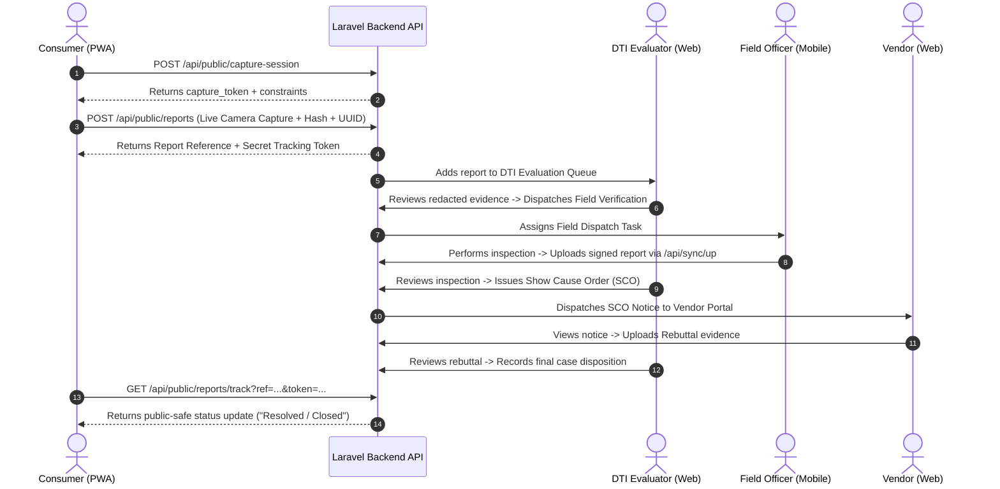

# PRICE-Watch Consumer PWA Implementation Plan

## 1. Executive Summary & Audit Overview
This document outlines the architectural migration plan for replacing the legacy mobile consumer interface with a zero-install, browser-first **Consumer Progressive Web Application (PWA)** for the PRICE-Watch system.

### Key Principles & Terminology Realignment
* **Tamper-Evident Evidence Acquisition:** Replaces legacy "tamper-proof" claims. Acknowledges that physical receipts are captured via camera-only browser interfaces, cryptographic SHA-256 server hashing, and sealed original storage, but final legal confirmation requires DTI human verification.
* **Zero Installation Barrier:** Consumers access all core features (SRP search, store directory, shelf price checker, formal receipt reporting, and report tracking) directly via standard URLs or QR codes without requiring application installation.
* **Monorepo Coexistence & Non-Interference:** The legacy `mobile/` Flutter application remains completely untouched and ignored. The new PWA resides in its own isolated directory: `customer-pwa/`.
* **Backend Single Source of Truth:** All regulatory calculations, SRP determinations, calamity state checks, evidence vaulting, status changes, and notice routing strictly take place on the Laravel backend API.

---

## 2. Discovered Repository Architecture

### Backend (`backend/`)
* **Framework & Engine:** Laravel 11.x on PHP 8.3.
* **Authentication:** Token-based authentication via Laravel Sanctum (`auth:sanctum`).
* **Database Provider:** Supabase PostgreSQL remote database (`cap_dti`).
* **Current Models:** `User`, `Store`, `SrpBulletin`, `ItemAlias`, `TemporalInspection`, `CitizenTip`, `LegalNotice`.
* **Current Storage Configuration:** Local private disk storage (`storage/app/private/receipt_vault`) for sensitive receipt evidence; public storage for generated PDF legal notices.

### Frontend Web Portal (`web/`)
* **Stack:** React 18, TypeScript, Vite, Vanilla CSS design tokens (Outfit typography, dark-mode glassmorphic theme), Leaflet.js (GIS store mapping), Chart.js (temporal price graph rendering), Axios.
* **Roles Served:** DTI Administrator / Evaluator, DTI Field Monitoring Officer, Store Manager / Vendor Portal.

### Mobile (`mobile/`)
* **Legacy Mobile App:** Flutter (Dart) app for Field Officer offline SQLite sync and legacy consumer capture. **Left 100% untouched.**

---

## 3. Existing vs. Missing Capabilities

| Feature Domain | Existing Backend Capability | Missing PWA Requirement | Planned Resolution |
| :--- | :--- | :--- | :--- |
| **Public SRP Search** | `/api/sync/down` (Requires Auth) | Public unauthenticated SRP search by commodity, brand, variant, size | Create `GET /api/public/commodities` |
| **Store Directory** | `Store::all()` via auth routes | Public establishment directory with search, barangay filter, map pins | Create `GET /api/public/establishments` |
| **Formal Capture Session** | Direct upload without session token | Server-issued short-lived capture token, session expiration & validation | Create `POST /api/public/capture-session` |
| **Formal Report Submission** | Generic `CitizenTip` upload | Full formal receipt report model with idempotency UUID, SHA-256 hashing, redacted copy generation, and secret tracking token | Create `POST /api/public/reports` & `ConsumerReport` migration |
| **Report Status Tracking** | Status field in `citizen_tips` | Public-safe status tracking via Reference + Secret Token with history logs | Create `GET /api/public/reports/track` & `ReportStatusHistory` |
| **Cross-User Integration** | Disconnected tip items | Direct link between Consumer Report → Evaluator Review → Field Dispatch → Vendor Notice | Update Evaluator, Dispatch, and Notice Controllers to link report IDs |

---

## 4. PWA Technology & Architecture Selection

### Stack Selection
To maintain 100% consistency with the existing active `web/` portal conventions:
* **Core:** React 18 + TypeScript + Vite.
* **PWA Engine:** `vite-plugin-pwa` with custom Workbox Service Worker setup.
* **Styling:** CSS Variables design system matching `web/src/index.css` (Outfit font, dark-mode glassmorphic cards, accessible responsive forms).
* **Media & Camera:** Web `MediaDevices.getUserMedia()` with fallback canvas rendering, bounding box overlay, glare/blur warnings, and live video capture (no gallery file picker for formal evidence).
* **Location & Maps:** Leaflet.js with OpenStreetMap tiles for establishment lookup.
* **Icons & Assets:** Vector SVG icons, standard web app manifest (`manifest.webmanifest`), and apple-touch-icon metadata.

---

## 5. Database Schema Extensions

We will create a clean, additive Laravel migration `2026_07_22_000001_create_customer_pwa_tables.php`:

1. **`capture_sessions`**:
   * `id`, `session_uuid`, `store_id`, `token_hash`, `expires_at`, `is_used`, `created_at`, `updated_at`.
2. **`consumer_reports`**:
   * `id`, `report_reference` (e.g. `REP-20260722-A8F2`), `tracking_token_hash`, `store_id`, `submission_uuid`, `capture_session_id`, `image_hash`, `image_vault_path`, `redacted_image_path`, `raw_ocr_json`, `consumer_confirmed_json`, `evaluator_confirmed_json`, `status`, `privacy_notice_version`, `user_ip`, `user_agent`, `created_at`, `updated_at`.
3. **`report_status_histories`**:
   * `id`, `consumer_report_id`, `previous_status`, `new_status`, `public_message`, `internal_notes`, `actor_type`, `actor_id`, `created_at`.

---

## 6. End-to-End Cross-User Flow Architecture

---

## 7. Security, Privacy & Offline Safeguards

1. **Security & Evidence Vaulting:**
   * Sealed original receipt stored in restricted private directory (`storage/app/private/receipt_vault`).
   * Redacted working copy generated for routine administrative review.
   * Access to original sealed evidence requires DTI Evaluator authorization and is audited.
   * Tracking tokens stored as bcrypt/SHA-256 hashes in database.

2. **Offline & Connection Resilience:**
   * Service worker caches static application shell, fonts, and icons for instant offline loads.
   * Network-first policy for regulatory SRP prices, calamity state, and store lists.
   * Unsent formal receipt drafts temporarily stored in IndexedDB (never localStorage) with a 24-hour expiration purge policy.
   * Clear visual banner informing user when price data is cached or offline.

---

## 8. Verification & Testing Strategy
1. **Backend Integration Tests:** PHPUnit test suite validating capture session creation, token expiration, idempotency UUID retries, SHA-256 duplicate detection, formal report submission, tracking token validation, and cross-user status transitions.
2. **PWA Frontend Build & Linting:** TypeScript static analysis (`tsc -b`) and Vite production build validation.
3. **Cross-User End-to-End Verification:** Testing full lifecycle from Consumer report submission to DTI Evaluator dispatch, Field Officer sync, Vendor rebuttal, and Consumer status tracking.
