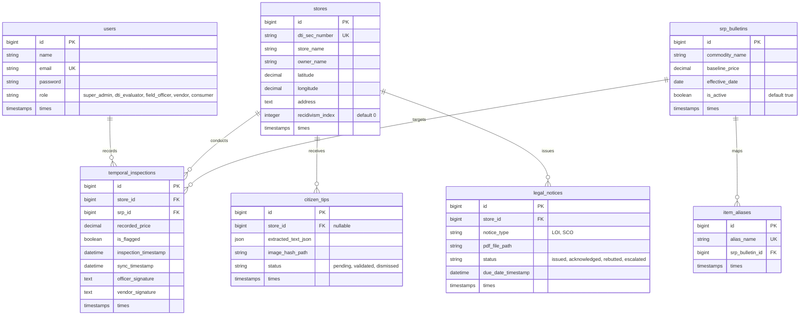

# PRICE-Watch Design Specification
**System Title**: A GIS-Mapped Temporal Monitoring System for Localized Commodity Price Regulation Utilizing Digitized Temporal Matrices and Tamper-Proof Evidence Acquisition
**Target Pilot Area**: San Jose de Buenavista, Antique
**Regulatory Body**: Department of Trade and Industry (DTI) Antique Provincial Office

---

## 1. Directory Structure (Monorepo)
The project will be organized as a decoupled monorepo under the root folder `c:\CAP101_DTI_SYS`:
* `/backend` — Central Laravel API backend.
* `/web` — React with TypeScript web dashboard (DTI Admin & Vendor Rebuttal Portal).
* `/mobile` — Flutter mobile application (Field Officer & Consumer flows).
* `/docs` — Documentation and design specifications.

---

## 2. Database Schema (Supabase PostgreSQL)
The remote PostgreSQL database `cap_dti` will house the following schema:

---

## 3. Core Architecture & Workflow Modules

### Module 1: GIS Vendor Onboarding
* **Flow**: React Web -> Laravel API -> Database.
* **Map Integration**: Admin uses `Leaflet.js` to pick spatial coordinates (lat/lng).
* **Onboarding Logic**: Laravel saves the store details, generates a random vendor password, creates a vendor user, and emails credentials.

### Module 2: Offline-First Temporal Field Monitoring
* **Flow**: Flutter -> Local SQLite -> Sync to Laravel.
* **Sync Protocol**:
  * **Downsync**: `/api/sync/down` fetches all stores, current SRP, and last 3 weeks of inspections to store locally in `sqflite`.
  * **Offline Monitoring**: Officer inputs prices offline. Flutter local math flags warnings: `recorded_price > baseline_price * 1.10`.
  * **Upsync**: `/api/sync/up` pushes local records when online. Laravel deduplicates and stores.

### Module 3: Tamper-Proof Consumer Tipping
* **Flow**: Flutter OCR -> Secure Vault -> Laravel Queue.
* **Device Lock**: Camera lock disables gallery uploads and draws aspect ratio bounds.
* **OCR engine**: On-device `google_ml_kit` parses receipt. Dart Regex ensures decimal structure (`\d+\.\d{2}`).
* **Secure Vault**: Images are cryptographically hashed and uploaded to Laravel’s private storage (`storage/app/private/receipt_vault`).

### Module 4: Temporal Analytics Dashboard
* **Flow**: React Web -> Chart.js -> Laravel API.
* **Emergency Protocol**: Global `state_of_calamity` state. When enabled, price allowance thresholds are deactivated, and UI alerts turn red.
* **Volatity Graph**: Renders 4-week temporal price charts.

### Module 5: Bifurcated Legal Engine
* **Condition A (Normal Market)**: `state_of_calamity == false && recidivism_index == 0`. Generates Letter of Inquiry (LOI) with 48-hour expiration.
* **Condition B (Emergency/Repeat Offender)**: `state_of_calamity == true || recidivism_index > 0`. Triggers direct Show Cause Order (SCO) and alerts dispatchers.
* **PDF Engine**: Laravel `dompdf` generates tamper-proof PDF notices.

---

## 4. Security & Compliance
* **API Authentication**: Laravel Sanctum (token-based).
* **Role-Based Access (RBAC)**: Enforced via Laravel middleware.
* **Data Encryption**: Receipts saved securely with restricted filesystem access.
* **MIME Validation**: Uploads strictly limited to `application/pdf`, `image/jpeg`, and `image/png`.
