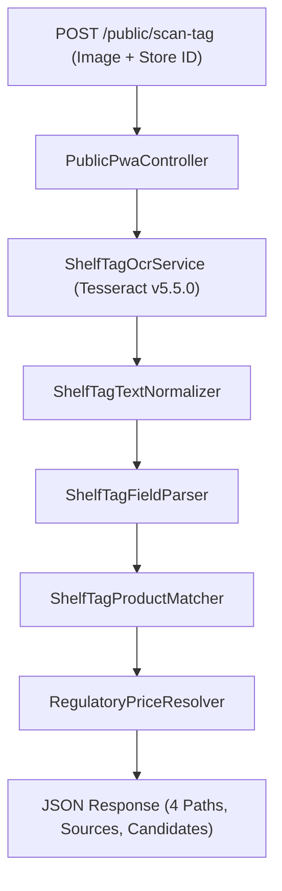
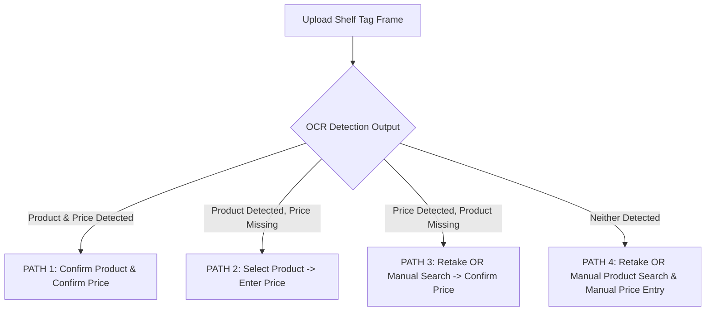

# PRICE-Watch Genuine Shelf-Tag OCR (Option A) Design Specification

**Date:** July 25, 2026  
**Status:** Approved  
**Target:** `customer-pwa/src/components/ShelfScanner.tsx` & `backend/app/`  

---

## 1. Executive Overview & Design Principles

This specification details the end-to-end technical architecture for transforming the PRICE-Watch Shelf Price Scanner from generic candidate selection into a genuine, image-to-text OCR-powered regulatory tool.

### Approved Core Principle:
> "The Shelf Price Scanner is an informational consumer reference tool. It compares a displayed shelf price with the applicable PRICE-Watch regulatory record. It does not automatically create a report, confirm a violation, update verified store history, initiate an investigation, issue a notice, or impose a penalty."

---

## 2. Backend Architecture & Service Boundaries

The backend scanner endpoint `POST /api/public/scan-tag` inside `PublicPwaController.php` coordinates five dedicated, single-responsibility services:

### Domain Services:

1. **`App\Services\Ocr\ShelfTagOcrService`**
   - Receives temporary uploaded file path from `storage/app/private/scan_vault`.
   - Invokes system Tesseract CLI (`C:\Program Files\Tesseract-OCR\tesseract.exe`) using `--psm 11` (sparse text) and `--psm 6` (uniform block).
   - Extracts raw text lines, word bounding boxes, and confidence metrics.
   - Deletes temporary image file immediately after processing completes.

2. **`App\Services\Ocr\ShelfTagTextNormalizer`**
   - Normalizes OCR misrecognitions: `O`➔`0`, `I`/`l`➔`1`, `S`➔`5`, `B`➔`8`, `P`/`PHP`/`₱`➔currency, `155G`➔`155 g`, `370ML`➔`370 mL`.

3. **`App\Services\Ocr\ShelfTagFieldParser`**
   - Searches near currency indicators (`₱`, `P`, `PHP`, `SRP`, `PRICE`) for decimal price patterns (`\d+\.\d{2}`).
   - Returns parsed numerical price candidate or `null`.

4. **`App\Services\Ocr\ShelfTagProductMatcher`**
   - Ranks active `srp_bulletins` records against normalized OCR text tokens (brand, commodity name, variant, package size, unit).
   - **STRICT RULE:** Returns candidate matches **ONLY if genuine token similarity exists**. If no genuine tokens match, returns an **empty array `[]`** (never returns generic top-5 commodities or Saba Sardines fallbacks).

5. **`App\Services\Ocr\RegulatoryPriceResolver`**
   - Resolves active pricing baseline based on global system state (`state_of_calamity`):
     - Normal market: Active baseline SRP (`"Current SRP"`).
     - Price freeze: Prevailing price cap (`"Frozen prevailing price"`).
     - APC active: Automatic Price Ceiling (`"Current APC ceiling"`).
   - Returns `REGULATORY_PRICE_UNAVAILABLE` if data is missing.

---

## 3. Four Truthful Execution Paths (Frontend State Machine)

The scanner contract enforces 4 distinct execution paths:

### Path Contracts:

1. **PATH 1: Both Product and Price Detected (`OCR_SUCCESS`)**
   - Shows OCR-matched product candidate list and detected tag price (`₱23.50`).
   - Consumer confirms exact product/package size and price before comparison.

2. **PATH 2: Product Detected, Price Missing (`PRODUCT_DETECTED_PRICE_MISSING`)**
   - Shows OCR-matched candidate products only.
   - Consumer selects product ➔ Prompt renders *"Enter the displayed shelf price"* with disclaimer:
     > *"The price could not be read clearly. Your entered price will be used only for this informational comparison and will not become an official DTI monitoring record."*
   - Price source recorded as `USER_ENTERED`.

3. **PATH 3: Price Detected, Product Missing (`PRICE_DETECTED_PRODUCT_MISSING`)**
   - Shows: *"We detected a possible shelf price (₱23.50), but we could not reliably identify the product."*
   - Actions: **Retake shelf tag** or **Search PRICE-Watch directory manually**.
   - If manual search selected: Consumer selects product (`MANUAL_SEARCH`), then confirms/corrects detected price (`USER_CONFIRMED` / `USER_CORRECTED`).

4. **PATH 4: Neither Product nor Price Detected (`OCR_NO_MATCH`)**
   - Shows: *"We could not reliably read this shelf tag."*
   - Actions: **Retake shelf tag**, **Search product manually**, **Open Prices**.
   - Requires manual product selection (`MANUAL_SEARCH`) and manual price entry (`USER_ENTERED`).

---

## 4. Value Source Metadata & UI Badging

Every scan result payload includes explicit source metadata:

- **`product_source`**: `OCR` | `BARCODE` | `MANUAL_SEARCH`
- **`price_source`**: `OCR` | `USER_CONFIRMED` | `USER_CORRECTED` | `USER_ENTERED`

The result card UI renders explicit source badges (`✔ OCR-Detected Tag Price` vs `✏️ Consumer-Entered Price`) so consumers are never misled.

---

## 5. Elimination of Synthetic Fallbacks & Error Handling

- All synthetic fallbacks (`detected_price: 23.50`, Saba Sardines defaults, fallback commodities on network failure) are completely removed from production builds.
- On API failure, render honest error state:
  > **Title:** *"Unable to analyze shelf tag"*  
  > **Message:** *"The shelf tag could not be processed. No comparison was generated and nothing was submitted."*  
  > **Actions:** [Try again], [Retake shelf tag], [Search prices manually], [Return to Scan]
